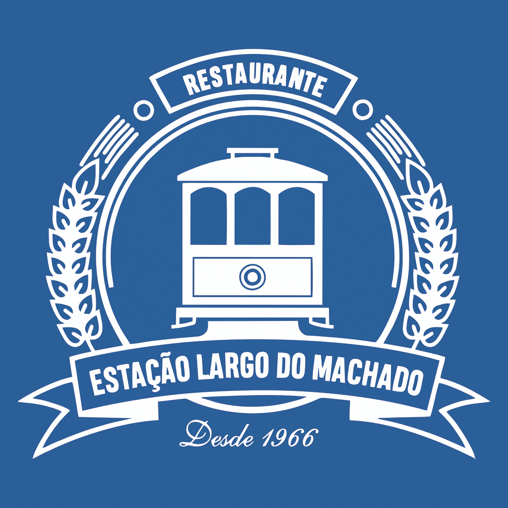

# 🍺 Restaurante Estação Largo do Machado — Website Oficial & Cardápio Digital

<p align="center">
  
</p>

<p align="center">
  <strong>Tradição Carioca Desde 1966 • Boteco 184 Ltda</strong><br>
  <em>Rua Bento Lisboa, 184 — Largo do Machado / Catete, Rio de Janeiro - RJ</em>
</p>

<p align="center">
  <a href="https://portfolio-estacao-largo-do-machado.pages.dev">
    
  </a>
  
  
  
</p>

<p align="center">
  🌐 <strong>Deploy Oficial:</strong> <a href="https://portfolio-estacao-largo-do-machado.pages.dev">https://portfolio-estacao-largo-do-machado.pages.dev</a>
</p>

---

## 📖 Sobre o Projeto

Website autoral e catálogo digital interativo desenvolvido para o **Restaurante Estação Largo do Machado (Boteco 184)**, ponto gastronômico histórico situado a 50 metros da estação de Metrô do Largo do Machado, no Catete, Rio de Janeiro.

O projeto une a rica essência da boemia tradicional carioca com tecnologia moderna de ponta, permitindo que clientes explorem o **cardápio completo de 136 itens reais**, consultem preços, opções de porções, horários e montem seu pedido em uma **Comanda Digital** com envio formatado direto para o WhatsApp oficial.

---

## 💎 Funcionalidades e Experiência do Usuário

- **🍱 136 Pratos e Bebidas Cadastrados**:
  - **24 Pratos Executivos Diários** servidos do almoço ao jantar durante todo o horário (a partir de R$ 29,90).
  - **Destaques da Casa**: Tradicional Feijoada Completa do Largo do Machado e o Cozido à Portuguesa aos domingos (porções individuais e para 2 a 3 pessoas).
  - **Carnes Nobres & À La Carte**: Filé à Oswaldo Aranha com alho dourado crocante, Picanha à Campanha, Picanha à Estação (com batatas gratinadas e feijão tropeiro), Medalhão ao Piamontese e Churrasco Misto.
  - **Peixes & Frutos do Mar**: Salmão com Alcaparras e Camarões, Bacalhau à Portuguesa e Camarões à Monte Carlo.
  - **Petiscos de Boteco**: Bolinho de Bacalhau artesanal de 1966, Bolinho de Feijoada, Pastéis fritos na hora, Dadinhos de Tapioca e Chapa "Pra Galera".
  - **Chopes & Cervejas**: Chopp Brahma cremoso tirado no ponto certo na tulipa e caldereta a R$ 10,90 e garrafas 600ml geladíssimas (Spaten, Original, Stella).
  - **Pizzas Artesanais & Sanduíches no Pão Francês Crocante**.
  - **Sobremesas Clássicas**: Pudim de leite lisinho, Brownie com sorvete, Petit Gâteau e Creme de Papaya com cassis.

- **🍸 Carta Autoral de Drinks do Catete**:
  - Coquetéis que homenageiam personalidades e esquinas históricas da região: *"Machado de Assis"*, *"Aterro do Flamengo"*, *"Clarisse Índio do Brasil"*, *"Rua das Laranjeiras 'Cássia Eller'"*, *"São Salvador"* e o mocktail *"Marquesa de Santos"*.

- **🌐 Suporte Multilíngue Completo (Português, Inglês e Espanhol)**:
  - Seletor de idioma intuitivo e elegante integrado na barra superior, navbar e menu mobile (🇧🇷 Português, 🇺🇸 English, 🇪🇸 Español).
  - Tradução completa da interface, categorias, pratos executivos, drinks autorais e itens do cardápio.
  - Comanda digital e mensagens de WhatsApp adaptadas dinamicamente ao idioma escolhido.
  - Persistência automática da preferência do visitante via `localStorage`.

- **🛍️ Comanda Digital & Pedido Direto no WhatsApp**:
  - Adição instantânea de itens à comanda com controle de quantidades.
  - Escolha entre **Entrega em Domicílio**, **Retirada no Balcão** ou **Consumo na Mesa**.
  - Campo de observações personalizadas (*"ponto da carne"*, *"sem cebola"*).
  - Geração automática da mensagem formatada com valores, itens e endereço, abrindo o WhatsApp do restaurante `(21) 2556-5323`.

- **⚡ Busca em Tempo Real & Filtros**:
  - Filtro instantâneo por nome, ingredientes ou categorias.
  - Tags rápidas (*"⭐ Mais Pedidos"*, *"🌱 Vegetarianos"*, *"👨‍👩‍👦 Para Compartilhar"*, *"🍺 Chopes & Bebidas"*).

- **⭐ Prova Social & Localização**:
  - Nota **4.8★ no Google com base em 992 avaliações reais**.
  - Mapa Google Maps interativo com rota para o Metrô Largo do Machado.
  - Informações completas de horários, formas de pagamento (aceita cartões de refeição VR, Sodexo, Alelo, Ticket).

---

## 🛠️ Stack Tecnológica

| Camada | Tecnologia |
| :--- | :--- |
| **Framework UI** | [React 19](https://react.dev/) |
| **Build Tool** | [Vite 6](https://vite.dev/) |
| **Estilização** | [Tailwind CSS v4](https://tailwindcss.com/) |
| **Ícones** | [Lucide React](https://lucide.dev/) |
| **Fontes** | *Playfair Display* (Editorial Serif) & *Plus Jakarta Sans* |
| **Hospedagem** | [Cloudflare Pages](https://pages.cloudflare.com/) |

---

## 🚀 Como Executar o Projeto

### Pré-requisitos
- [Node.js](https://nodejs.org/) (versão 18+ recomendada)
- npm ou yarn

### 1. Clonar o repositório
```bash
git clone https://github.com/Venoy-Studio/portfolio-estacao-largo-do-machado.git
cd portfolio-estacao-largo-do-machado
```

### 2. Instalar dependências
```bash
npm install
```

### 3. Rodar em ambiente de desenvolvimento
```bash
npm run dev
```
Acesse [http://localhost:3000](http://localhost:3000) no seu navegador.

### 4. Gerar build de produção
```bash
npm run build
```
Os arquivos otimizados serão gerados na pasta `dist/`.

### 5. Versão Autônoma (Sem Dependências)
Caso queira testar diretamente sem iniciar servidores, basta dar duplo clique no arquivo [`standalone_preview.html`](./standalone_preview.html) ou executar [`abrir_site.bat`](./abrir_site.bat).

---

## 📂 Estrutura de Arquivos

```
portfolio-estacao-largo-do-machado/
├── public/
│   └── images/                # Fotos oficiais da fachada, banners e logotipo
├── src/
│   ├── components/
│   │   ├── Navbar.jsx         # Cabeçalho fixo com status ao vivo e comanda
│   │   ├── Hero.jsx           # Destaque com galeria interativa de fotos
│   │   ├── Features.jsx       # 4 pilares gastronômicos da casa
│   │   ├── FeaturedDishBanner.jsx # Feijoada & Cozido de Domingo
│   │   ├── MenuSection.jsx    # Cardápio completo com busca e 19 categorias
│   │   ├── DrinksShowcase.jsx # Drinks autorais homenageando o Catete
│   │   ├── HeritageSection.jsx# História de 60 anos no Largo do Machado
│   │   ├── ReviewsSection.jsx # Avaliações 4.8★ verificadas no Google
│   │   ├── LocationSection.jsx# Mapa Google Maps, metrô e formas de pagamento
│   │   ├── CartDrawer.jsx     # Gaveta da Comanda Digital com envio WhatsApp
│   │   ├── MobileBottomBar.jsx# Barra ergonômica inferior para smartphones
│   │   └── Footer.jsx         # Dados fiscais (CNPJ, Razão Social) e links
│   ├── data/
│   │   └── restaurantData.json# Base completa de 136 pratos e informações
│   ├── App.jsx                # Componente raiz e gerenciamento de estado
│   ├── index.css              # Estilos globais e tokens Tailwind CSS v4
│   └── main.jsx
├── standalone_preview.html    # Versão HTML autônoma com dados embutidos
├── abrir_site.bat             # Atalho de execução rápida no Windows
├── iniciar_servidor_dev.bat   # Atalho para iniciar o servidor de desenvolvimento
├── package.json
└── vite.config.js
```

---

## 📍 Informações do Estabelecimento

- **Razão Social:** BOTECO 184 LTDA
- **CNPJ:** 46.859.491/0001-21
- **Endereço:** Rua Bento Lisboa, 184 — Largo do Machado / Catete, Rio de Janeiro - RJ (CEP 22221-011)
- **Horário:** Todos os dias das 11:00 às 00:00 (Meia-noite)
- **Telefone / WhatsApp:** (21) 2556-5323

---

<p align="center">
  Desenvolvido com excelência por <strong>Venoy Studio</strong>
</p>
